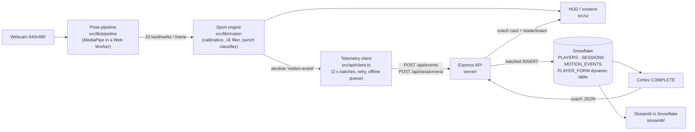

# Architecture

If the API is down, `src/api` falls back to mock data. If Snowflake is down, the server's `SNOWFLAKE_MOCK=1` mode answers instead. Either way the demo keeps running.

## Folders

| Folder | What it is | Owner |
| --- | --- | --- |
| `src/lib/pipeline` | Webcam capture, MediaPipe worker, adaptive quality, player tracking | Naman |
| `src/lib/motion` | Calibration, 1€ filter, punch/guard/slip classification, round metrics | Naman |
| `src/ui` | Calibration overlay, boxing HUD, post-match, leaderboard, demo page | Naman |
| `src/api` | Browser API client, event queue, mock backend, `CONTRACT.md` | Naman |
| `src/dev`, `src/main.ts` | Temporary app glue and keyboard mock round | Naman |
| `server` | Express API, event write-behind queue, Cortex coach | Sankar |
| `sql` | Snowflake schema, dynamic table, analytics views (`CONTRACT.md`) | Sankar |
| `streamlit` | Streamlit in Snowflake dashboard + "Ask the Coach" | Sankar |
| `scripts` | Seed data generator, API smoke test, mock end-to-end run | Sankar |
| `ideas`, `motion-sports-research.md` | Idea list and research | Rohan / team |
| `docs` | This file, JetBrains Air usage | Team |
